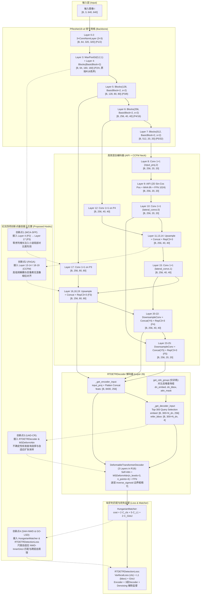

# 01 项目快速理解报告（Project Understanding Report）

## 1. 项目总体架构

本项目（[`lishun-lishun/RTDETR-main`](https://github.com/lishun-lishun/RTDETR-main) 及其历史消融分支 [`codex/uav-research-integration`](https://github.com/lishun-lishun/RTDETR-main/tree/codex/uav-research-integration)）是基于 **Ultralytics YOLOv8.0.201** 框架移植与深度定制的 **RT-DETR（Real-Time DEtection TRansformer）** 目标检测工程，专门面向 **DUT-Anti-UAV**（[Zhao et al., IEEE T-ITS 2022](https://github.com/wangdongdut/DUT-Anti-UAV)）可见光复杂背景下的远距离微小无人机（UAV）检测任务。

需要特别区分的是：
- **非 PaddleDetection 官方实现**：本项目不使用 Paddle 框架的 YAML 依赖注入体系，而是遵循 Ultralytics 的 `[from, repeats, module, args]` 序列式配置解析与 `parse_model` 工厂机制。
- **非 D-FINE / DEIM 独立仓库**：项目的模型基类继承自 `ultralytics/nn/tasks.py` 中的 `DetectionModel -> RTDETRDetectionModel`，训练器与验证器分别位于 `ultralytics/models/rtdetr/train.py` 与 `ultralytics/models/rtdetr/val.py`。
- **数据集与任务特征**：单类别检测（`nc = 1`，类别为 `UAV`），输入尺寸统一为 `640×640`。DUT-Anti-UAV 包含 10,000 张可见光图像（训练集 5,200 张、验证集 2,600 张、测试集 2,200 张共 2,245 个目标实例），目标平均面积占比仅约 0.013，最小目标占比低至 $1.9\times 10^{-6}$，且包含大量云层边缘、树冠遮挡、城市建筑天际线及飞鸟等高相似强背景干扰。



## 2. 原始 RT-DETR-R18 网络结构与YAML解析

在 `ultralytics/cfg/models/rt-detr/rtdetr-r18.yaml` 中，模型由 `backbone`（第 0–7 层）和 `head`（第 8–26 层）组成，总参数量约 **20.08M**（COCO 80类为 20.18M，单类别 `nc=1` 时约 19.87M–20.08M），计算量约 **56.9–58.6 GFLOPs**。

| 层号 (Index) | 来源 (from) | 重复 (n) | 模块名称 (module) | 配置参数 (args) | 输出张量尺寸 (`640×640` 输入) | 功能角色说明 |
| :--- | :--- | :--- | :--- | :--- | :--- | :--- |
| 0 | -1 | 1 | `ConvNormLayer` | `[32, 3, 2, None, False, 'relu']` | `[B, 32, 320, 320]` | Stem 下采样 (stride=2, P1/2) |
| 1 | -1 | 1 | `ConvNormLayer` | `[32, 3, 1, None, False, 'relu']` | `[B, 32, 320, 320]` | Stem 局部卷积 |
| 2 | -1 | 1 | `ConvNormLayer` | `[64, 3, 1, None, False, 'relu']` | `[B, 64, 320, 320]` | Stem 通道扩展 |
| 3 | -1 | 1 | `nn.MaxPool2d` | `[3, 2, 1]` | `[B, 64, 160, 160]` | Stem 池化下采样 (stride=4) |
| 4 | -1 | 1 | `Blocks` | `[64, BasicBlock, 2, 2, 'relu']` | `[B, 64, 160, 160]` | **Stage 2 (P2/4)**，原始 R18 丢弃不用 |
| 5 | -1 | 1 | `Blocks` | `[128, BasicBlock, 2, 3, 'relu']` | `[B, 128, 80, 80]` | **Stage 3 (P3/8)**，送入 Neck Layer 17 |
| 6 | -1 | 1 | `Blocks` | `[256, BasicBlock, 2, 4, 'relu']` | `[B, 256, 40, 40]` | **Stage 4 (P4/16)**，送入 Neck Layer 12 |
| 7 | -1 | 1 | `Blocks` | `[512, BasicBlock, 2, 5, 'relu']` | `[B, 512, 20, 20]` | **Stage 5 (P5/32)**，送入 Neck Layer 8 |
| 8 | -1 | 1 | `Conv` | `[256, 1, 1, None, 1, 1, False]` | `[B, 256, 20, 20]` | P5 通道投影 (`input_proj.2`) |
| 9 | -1 | 1 | `AIFI` | `[1024, 8]` | `[B, 256, 20, 20]` | P5 尺度内多头自注意力交互 (400 tokens) |
| 10 | -1 | 1 | `Conv` | `[256, 1, 1]` | `[B, 256, 20, 20]` | `Y5` (`lateral_convs.0`) |
| 11–14 | `[-1, 6]` | 3 | `Upsample + Conv + Concat + RepC3` | `[256, 0.5]` | `[B, 256, 40, 40]` | Top-Down P5→P4 融合 (`fpn_blocks.0`) |
| 15 | -1 | 1 | `Conv` | `[256, 1, 1]` | `[B, 256, 40, 40]` | `Y4` (`lateral_convs.1`) |
| 16–19 | `[-1, 5]` | 3 | `Upsample + Conv + Concat + RepC3` | `[256, 0.5]` | `[B, 256, 80, 80]` | Top-Down P4→P3 融合，输出 **`X3` (Layer 19)** |
| 20–22 | `[-1, 15]` | 3 | `Conv(s=2) + Concat + RepC3` | `[256, 0.5]` | `[B, 256, 40, 40]` | Bottom-Up P3→P4 融合，输出 **`F4` (Layer 22)** |
| 23–25 | `[-1, 10]` | 3 | `Conv(s=2) + Concat + RepC3` | `[256, 0.5]` | `[B, 256, 20, 20]` | Bottom-Up P4→P5 融合，输出 **`F5` (Layer 25)** |
| 26 | `[19, 22, 25]` | 1 | `RTDETRDecoder` | `[nc, 256, 300, 4, 8, 3]` | 训练: 5元组 / 推理: `[B, 300, 4+nc]` | 3层可变形 Transformer 解码器 (R18 为 `ndl=3`) |

## 3. Backbone 与 Neck 特征融合流程（AIFI & CCFM）

1. **PResNet18-vd 骨干特征提取**：
   - 采用 3 个 $3\times 3$ 卷积构成的 Deep Stem 替代标准 ResNet 的 $7\times 7$ 卷积，在 Stage 3/4/5 的残差跳连分支中使用 `AvgPool2d(2, 2) + Conv1x1`（ResNet-vd 变体）缓解步长卷积造成的特征丢弃。
   - **关键缺陷 1（P2 高频与边缘信息彻底丢弃）**：Layer 4 输出的 `P2/4`（$160\times 160$，64通道）包含远距离微小无人机（在 $640\times 640$ 下往往仅 $4\times 4 \sim 12\times 12$ 像素）最宝贵的亚像素边缘与局部对比度信息，但原始 `rtdetr-r18.yaml` 完全未引用 Layer 4，直接从 Layer 5 (`P3/8`, $80\times 80$) 开始构建特征金字塔。而在 $80\times 80$ 特征图上，$6\times 6$ 像素的无人机仅占不到 1 个网格点！
2. **AIFI（Attention-based Intra-scale Feature Interaction）**：
   - 位于 `ultralytics/nn/modules/transformer.py`。将 Layer 8 输出的 `[B, 256, 20, 20]` 展平为 `[B, 400, 256]`，叠加 `build_2d_sincos_position_embedding` 生成的无参数 2D 正余弦位置编码（强制 FP32 计算以保证导出与数值精度），经过 1 层 8 头自注意力与 FFN（`cm=1024`）后重塑回 `[B, 256, 20, 20]`。
3. **CCFM（CNN-based Cross-scale Feature Fusion Module）**：
   - 采用自顶向下（FPN）+ 自底向上（PAN）双向路径，核心算子为 `nn.Upsample(scale_factor=2, mode='nearest')`、`Concat` 和 `RepC3(c1, c2, n=3, e=0.5)`。
   - **关键缺陷 2（最近邻上采样混叠与跨尺度相位错位）**：`nearest` 插值上采样在将深层粗糙特征（$20\times 20 \to 40\times 40 \to 80\times 80$）直接拼接到浅层特征时，会产生阶梯状伪影（checkerboard/interpolation aliasing）与高达 $0.5\sim 1.5$ 个网格的亚像素空间偏移；同时，高层特征中的大面积云层/树冠背景激活会淹没浅层 $P_3$ 中微弱的点状无人机响应。

## 4. RTDETRDecoder、Query 选择与逐层精化机制

`RTDETRDecoder`（位于 `ultralytics/nn/modules/head.py`）接收 `[X3, F4, F5]` 三个尺度的特征列表：
1. **`_get_encoder_input(x)`**：
   - 分别通过 `self.input_proj`（$1\times 1$ Conv + BN）映射为 `hd=256` 维，展平并沿 token 维拼接得到编码器记忆 `feats`（形状 `[B, 8400, 256]`，其中 $80^2 + 40^2 + 20^2 = 6400 + 1600 + 400 = 8400$），并记录 `shapes = [[80, 80], [40, 40], [20, 20]]`。
2. **`get_cdn_group(...)`（对比去噪训练分支，位于 `ops.py`）**：
   - 仅在 `self.training=True` 时激活。根据当前 batch 最大 GT 数 `max_nums` 构建 `num_group = max(1, 100 // max_nums)` 个去噪组，每组包含正去噪查询（小尺度噪声）和负去噪查询（大尺度偏移与随机类别翻转）。通过构造布尔型 `attn_mask`（形状 `[num_dn + 300, num_dn + 300]`）严格隔离去噪查询与匹配查询，防止 GT 信息泄露。
3. **`_get_decoder_input(feats, shapes, dn_embed, dn_bbox)`（Query 选择核心链路）**：
   - `_generate_anchors`：在三个尺度网格中心生成归一化锚框 `anchors`（形状 `[1, 8400, 4]`），基础宽高为 $w=h=0.05 \times 2^l$（即在 $P_3, P_4, P_5$ 上分别为 $0.05, 0.10, 0.20$，对应 640 图像上的 $32\times 32, 64\times 64, 128\times 128$ 像素！），随后转换到 logit 域 $\ln(a/(1-a))$ 并通过 `valid_mask` 屏蔽边界外锚点。
   - **关键缺陷 3（Query 选择的分类置信度盲区与锚框尺度偏置）**：
     ```python
     features = self.enc_output(valid_mask * feats)           # [B, 8400, 256]
     enc_outputs_scores = self.enc_score_head(features)       # [B, 8400, nc]
     topk_ind = torch.topk(enc_outputs_scores.max(-1).values, self.num_queries, dim=1).indices
     ```
     尽管 RT-DETR 论文（[Zhao et al., CVPR 2024](https://openaccess.thecvf.com/content/CVPR2024/html/Zhao_DETRs_Beat_YOLOs_on_Real-time_Object_Detection_CVPR_2024_paper.html)）声称使用了 Uncertainty-Minimal Query Selection，但在 **Ultralytics YOLOv8.0.201 的实际源码实现中**，选点逻辑仅仅是对 `enc_outputs_scores.max(-1).values`（纯分类响应）取 Top-300，完全没有衡量定位不确定性或局部前景显著性！对于低对比度、模糊的远距离微小无人机，其初始分类响应极弱，极易被复杂背景（如树枝伪目标、建筑边角）挤出 Top-300；且默认基础锚框最小为 $32\times 32$ 像素（`grid_size=0.05`），对 $6\times 6$ 像素的微小无人机严重偏大。
4. **`DeformableTransformerDecoder` 与 `MSDeformAttn`**：
   - 包含 `ndl=3` 层（R18 配置）。每层依次执行：Query 自注意力 $\to$ 多尺度可变形交叉注意力（`MSDeformAttn`，`n_levels=3, n_heads=8, n_points=4`） $\to$ FFN。
   - 在 `MSDeformAttn.forward` 中，框模式（`refer_bbox` 最后一维为 4）下的采样点坐标计算公式为：
     $$\text{sampling\_locations} = \text{refer\_bbox}_{:,:,:2} + \frac{\text{sampling\_offsets}}{n_{\text{points}}} \cdot \text{refer\_bbox}_{:,:,2:} \cdot 0.5$$
   - **关键缺陷 4（微小目标在 MSDeformAttn 中的采样点坍缩效应）**：当 `refer_bbox` 收敛到一个 $6\times 6$ 像素的微小无人机（归一化宽高 $w, h \approx 0.009$）时，采样偏移被乘以 $0.5 \times w \approx 0.0045$。在 $P_3$（$80\times 80$，步长 $1/80 = 0.0125$）特征图上，4 个采样点全部坍缩在同一个网格像素内部，彻底丧失了对目标边界与周围局部上下文的感知能力，导致 `AP75` 和 `mAP50:95` 出现严重瓶颈！

## 5. Hungarian Matching 与 Loss 计算机制

位于 `ultralytics/models/utils/ops.py` 与 `ultralytics/models/utils/loss.py`：
1. **`HungarianMatcher`**：
   - 代价矩阵：$\mathcal{C} = \lambda_{\text{cls}} \mathcal{C}_{\text{cls}} + \lambda_{\text{bbox}} \mathcal{C}_{L_1} + \lambda_{\text{giou}} \mathcal{C}_{\text{GIoU}}$，默认权重 `cost_gain={'class': 2, 'bbox': 5, 'giou': 2}`。
   - 使用 `scipy.optimize.linear_sum_assignment` 在每张图像内完成一对一（One-to-One）二分图最优匹配。
2. **`RTDETRDetectionLoss(DETRLoss)`**：
   - 将 Encoder Top-300 预测与 3 层 Decoder 预测拼接为 `[4, B, 300, 4]`（R18 中为 1+3=4 层），最后一层计算主损失，前 3 层计算 `_get_loss_aux`，去噪分支通过固定索引计算 `_dn` 损失。
   - 分类损失默认采用 `VarifocalLoss (VFL)`（`use_vfl=True`），以 `gt_scores = bbox_iou(pred_bboxes.detach(), gt_bboxes, xywh=True)` 作为软标签 $q$；回归损失采用 $5 \cdot \mathcal{L}_{L_1} + 2 \cdot \mathcal{L}_{\text{GIoU}}$。
   - **关键缺陷 5（微小目标的 IoU 悬崖效应与 VFL 正样本饥饿）**：对于 $8\times 8$ 像素的无人机，仅 2 个像素的中心预测偏差就会使 IoU 从 $1.0$ 暴跌至 $0.36$，4 个像素偏差即跌至 $0.14$。这导致：(a) `HungarianMatcher` 中 GIoU 代价剧烈抖动，层间匹配索引频繁跳变；(b) VFL 中目标软标签 $q = \text{IoU}$ 接近于 0，正如 [DEIM (CVPR 2025)](https://arxiv.org/html/2412.04234v3) 所揭示的，VFL 对低 IoU 匹配的正样本梯度近乎消失，导致微小目标在训练中陷入“低 IoU $\to$ 低 VFL 软标签 $\to$ 梯度消失 $\to$ 无法精化定位”的恶性循环。

## 6. `parse_model` 模块注册机制与新模块最佳接入位置

在 `ultralytics/nn/tasks.py` 的 `parse_model(d, ch, verbose=True)` 中：
- 普通单输入模块（如 `Conv`, `RepC3`）：自动从 `ch[f]` 读取输入通道 `c1`，从 YAML `args[0]` 读取输出通道 `c2` 并乘以宽度系数。
- 多输入融合模块（如 `Concat` 或自定义跨层模块）：`f` 为列表（如 `[4, 5]` 或 `[-1, 6]`），此时传入模块构造函数的通道参数可通过 `[ch[x] for x in f]` 获取，且在 `RTDETRDetectionModel.predict` 中自动将 `[y[j] for j in m.f]` 打包为 `list[Tensor]` 传入 `m.forward(x)`。
- **最佳可拆卸接入位置总结**：
  1. **浅层特征增强接入点**：在 Backbone Layer 4 (`P2/4`) 与 Neck Layer 17 (`P3/8`) 之间接入多输入模块 `[ [4, 5], 1, WCASFP, [128] ]`，在不增加 Transformer 序列长度（仍保持 8400 tokens）的前提下将 P2 亚像素边缘与局部对比度信息注入 P3。
  2. **跨尺度融合接入点**：在 Neck 的 Top-Down 融合处（Layer 13–14 及 Layer 18–19）用频空门控与亚像素相位对齐模块 `FAGA` 替代粗糙的 `Upsample + Concat`，消除插值混叠与跨层错位。
  3. **Decoder 与 Query 选择接入点**：扩展 `RTDETRDecoder`（或子类化/钩子注入 `UADCRDecoder`），改良 `_get_decoder_input` 的混合不确定性评分与自适应尺度锚框，并在 `MSDeformAttn` 中引入针对微小目标的最小采样跨度下界（Variance Floor）与细粒度残差精化。
  4. **训练监督与匹配接入点**：扩展 `RTDETRDetectionLoss` 与 `HungarianMatcher`（推理期零开销），引入尺度自适应 Wasserstein-InnerGIoU 混合匹配/回归损失、Matchability-Aware 软标签校准以及跨层全局最优自蒸馏（GO-LSD）。
